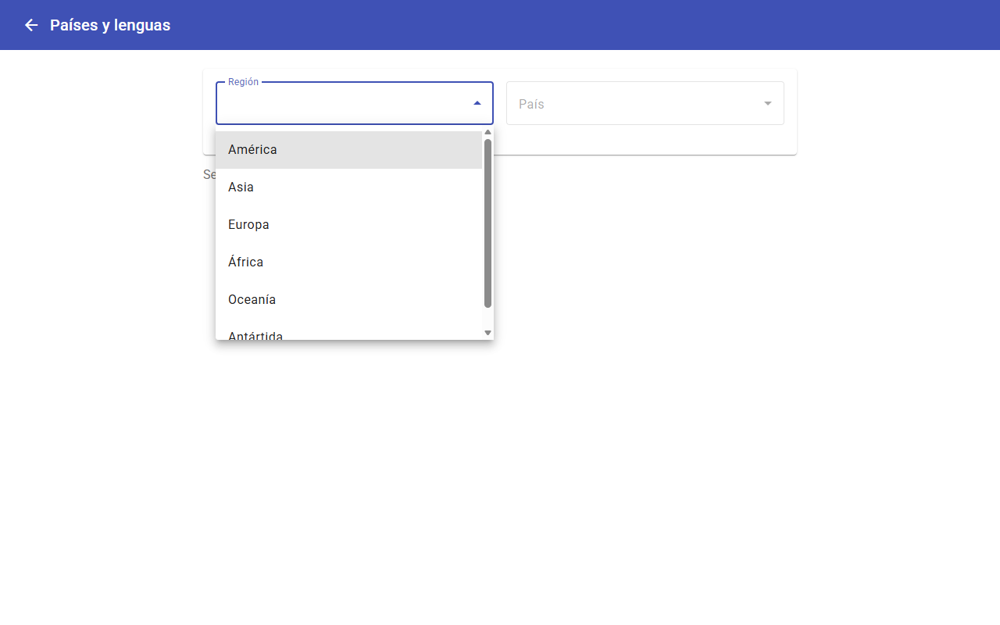
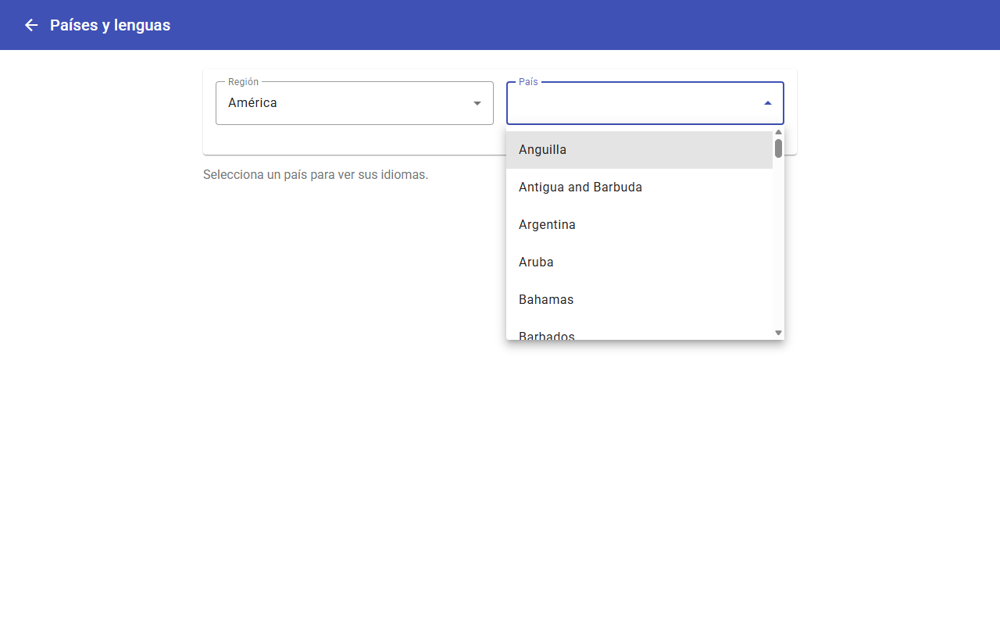
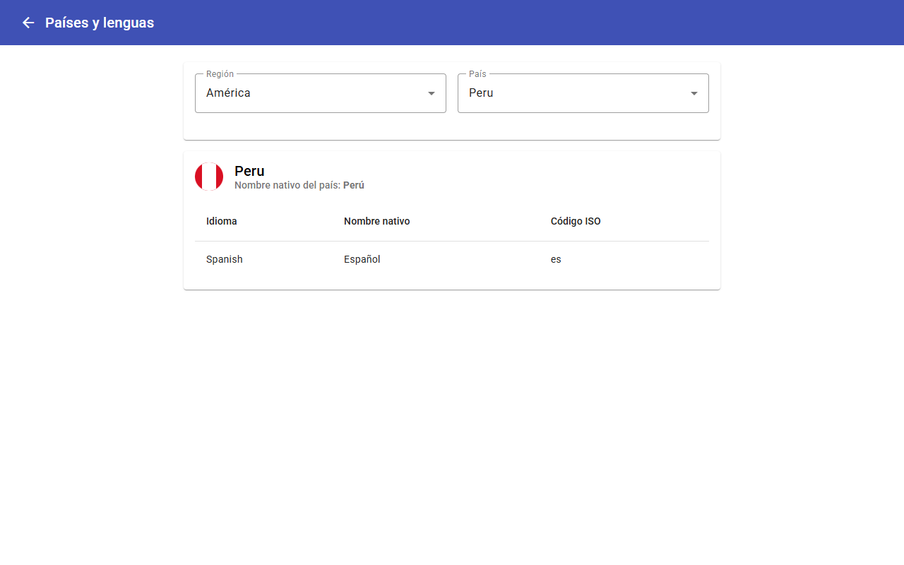
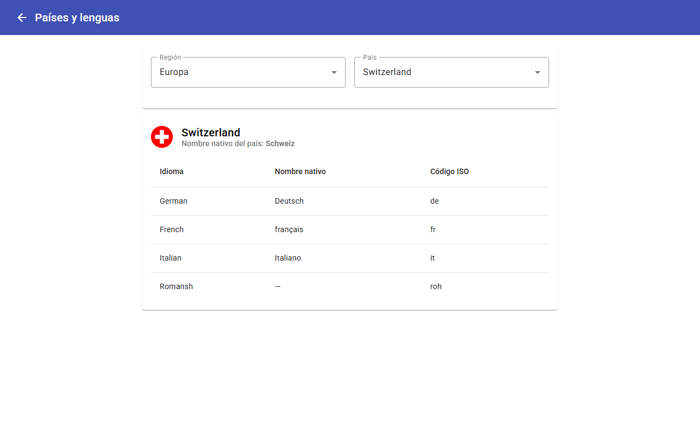
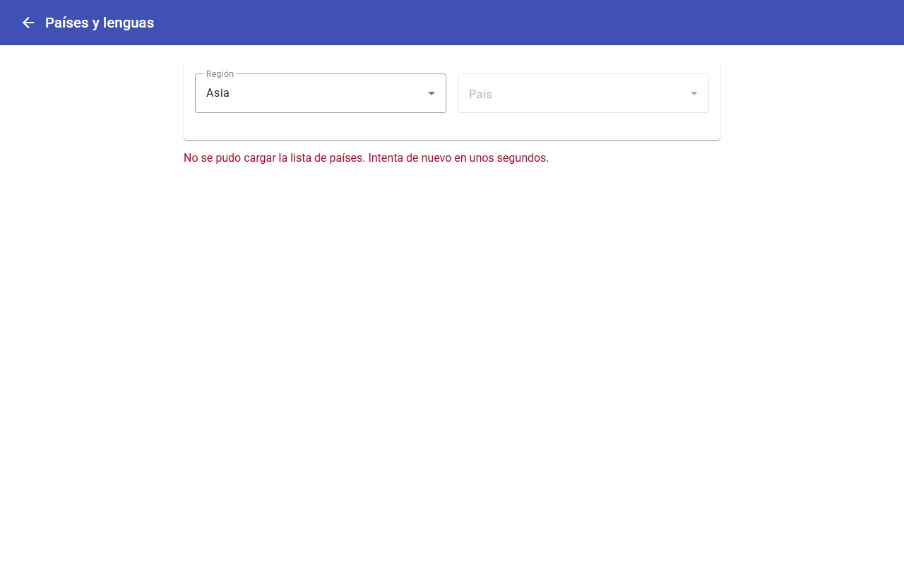

# CetproNicolTecnologia
## Código Supabase: iMryYfJelP5TmyOc

## Cómo correr el proyecto

**Requisitos:** .NET 8 SDK, Node.js 18+ y Angular CLI (`npx` es suficiente, no hace falta instalarlo global).

**1. Backend (API .NET)**
```bash
cd cetproBack/src/CetproNicol.API
dotnet run --launch-profile https
```
Queda en `https://localhost:7260` (Swagger en `https://localhost:7260/swagger`). La primera vez que el navegador llame a esa URL puede advertir por el certificado de desarrollo; entra una vez a Swagger y acepta la excepción antes de usar el frontend.

**2. Frontend (Angular)**
```bash
cd cetproFront
npm install   # solo la primera vez
npx ng serve --port 4200
```
Queda en `http://localhost:4200`.

**3. Probarlo**
Usuario admin semilla: `admin@cetpronicol.com` / `Admin123!`. También puedes registrar un estudiante nuevo desde `/registro`. El connection string de Supabase usa el puerto 5432 (session pooler); si necesitas correr una migración nueva, usa ese puerto y no el 6543 (transaction pooler, no soporta bien las migraciones de EF Core).

## Dónde están las funciones stateless / stateful / i18n

**Stateful (modifican datos, con transacción):**
- `MatriculaService.MatricularEstudianteAsync` (`cetproBack/src/CetproNicol.Application/Services/MatriculaService.cs`) — `POST /api/matriculas`, UI en `SolicitarComponent`.
- `MatriculaService.AprobarPagoAsync` (mismo archivo) — `PUT /api/pagos/{id}/aprobar`, UI en `PagosComponent` (admin).

**Stateless (solo consulta/cálculo):**
- `MatriculaService.CalcularDeudaEstudianteAsync` — `GET /api/matriculas/{id}/deuda`, UI en el diálogo "Ver deuda" de `MisCursosComponent`.
- `ContenidoService.VerificarAccesoContenidoAsync` (`ContenidoService.cs`) — `GET /api/contenidos/verificar-acceso`, UI en el chip "Verificar acceso" de `MisCursosComponent`.

**i18n (ngx-translate):**
- Archivos de traducción: `cetproFront/src/assets/i18n/{es,en}.json`.
- Configuración: `cetproFront/src/app/app.config.ts` (`provideTranslateService`).
- Selector de idioma: `shared/header/header.ts`.
- Textos traducidos: `Header`, `Login`, `Registro` y `SolicitarComponent` (el resto de pantallas admin quedó en español fijo, fuera del alcance pedido).

## Consumo de la API RENIEC desde el frontend

La verificación de DNI en `SolicitarComponent` llama directo a la API de RENIEC **desde Angular**, sin pasar por el backend .NET.

- **Dónde:** `ReniecService.buscarPorDni()` (`cetproFront/src/app/core/services/reniec.service.ts`) hace `GET https://api.apis.net.pe/v2/reniec/dni?numero={dni}` con `Authorization: Bearer {environment.reniecToken}`.
- **Token:** se configura en `environment.ts` / `environment.prod.ts` (clave `reniecToken`); reemplazar el placeholder `TU_TOKEN_AQUI` por un token real de apis.net.pe.
- **Disparo:** en `SolicitarComponent` (`solicitar.ts`), el campo `dni` del formulario se escucha con `debounceTime(500)` + `distinctUntilChanged()` + `filter` (solo dispara con 8 dígitos exactos), y llama a `verificarDni()`.
- **Interceptor:** `authInterceptor` solo agrega el JWT propio a peticiones hacia `environment.apiUrl`; la llamada a RENIEC no lleva ese header, para no pisar el `Authorization` que necesita RENIEC.

**Posible falla por CORS:** la API de RENIEC puede rechazar la petición hecha directo desde el navegador con un error de CORS (`No 'Access-Control-Allow-Origin' header...`), independientemente de si el token es válido — es una restricción del lado del servidor de RENIEC, no del código de este proyecto. Cuando eso ocurre, `catchError` lo captura y la UI cae al estado `no-encontrado`, dejando los campos Nombre/Apellido habilitados para completarlos manualmente. Si se necesita evitar ese error de CORS, la única solución real sería proxear la llamada a través del backend, lo cual queda fuera del alcance actual (se pidió explícitamente consumir RENIEC solo desde el frontend).

## Vista de países y lenguas (API de países)

Vista pública en `http://localhost:4200/paises` (no requiere login; hay enlace desde el login, el sidebar del admin y el menú del estudiante). Tiene dos listas desplegables, **Región** y **País**, y una tabla con **Idioma / Nombre nativo / Código ISO** del país elegido. Al elegir una región se recarga la lista de países; al elegir un país se muestra la tabla.

**Cómo se hizo:**
1. **Elección de la API.** `restcountries.com/v3.1` está deprecada (responde 301 a un JSON de error que pide migrar a la v5). La alternativa `apicountries.com` redirige (301) a **`https://countries.dev`**, que sí responde, no pide token, devuelve cada idioma con su `nativeName` y permite CORS (`access-control-allow-origin: *`, preflight 204), por lo que se consume directo desde Angular. La URL base está en `environment.countriesApiUrl` (`environment.ts` y `environment.prod.ts`).
2. **Regiones estáticas.** La API no tiene un endpoint que liste regiones, así que están fijas en `REGIONES_PAISES` (`cetproFront/src/app/core/services/paises.service.ts`): `americas`, `asia`, `europe`, `africa`, `oceania`, `antarctic`. Cada una lleva su clave de traducción.
3. **Servicio.** `PaisesService.getPorRegion(region)` hace `GET {countriesApiUrl}/region/{region}` y ordena los países por nombre. Modelos en `core/models/paises.models.ts`.
4. **Componente.** `features/paises/paises.ts` usa signals (la app no usa zone.js). Elegir una región dispara la carga mediante un `Subject` + `switchMap` (si se cambia de región antes de que responda la anterior, se descarta esa respuesta) y reinicia país y tabla. El país elegido se busca con un `computed` dentro de la lista ya cargada: la respuesta de la región ya trae los idiomas, así que no hace falta una segunda petición. Si la API falla, `catchError` muestra un mensaje y deja deshabilitada la lista de países.
5. **Ruta y textos.** Ruta `paises` en `app.routes.ts` (sin `authGuard`) y claves `PAISES.*` en `assets/i18n/{es,en}.json`, así que la vista respeta el idioma guardado. `authInterceptor` no agrega el JWT propio a esta llamada porque solo lo hace hacia `environment.apiUrl`.

**Capturas del flujo asíncrono** (cada cambio de lista dispara una llamada HTTP a la API de países):

1. **Región elegida.** La lista de regiones es estática (no hay llamada todavía).
   
2. **Países cargados.** Al elegir "América" se hizo `GET /region/americas` y el combo País se habilita con la respuesta.
   
3. **País elegido.** Se muestra la tabla Idioma / Nombre nativo / Código ISO sin una segunda petición (los idiomas ya venían en la respuesta de la región).
   
4. **País con varios idiomas.** Suiza tiene 4; Romansh no trae nombre nativo y se muestra "—".
   
5. **Falla de la API.** `catchError` muestra el mensaje y deja deshabilitado el combo País.
   

**Nota:** al ser un servicio de terceros, si `countries.dev` cambia su formato o deja de estar disponible, el único punto a ajustar es `PaisesService` (y `countriesApiUrl`).

